# D365 F&O Architecture Diagrams

> **Glossary:** See the [Business Glossary](../00-foundations/d365-business-glossary.md) for term definitions.

> **Copy-paste these into Markdown viewers that support Mermaid** (GitHub, VS Code, Notion, Obsidian, mkdocs-material)

---

## 1. Four Pillars Architecture

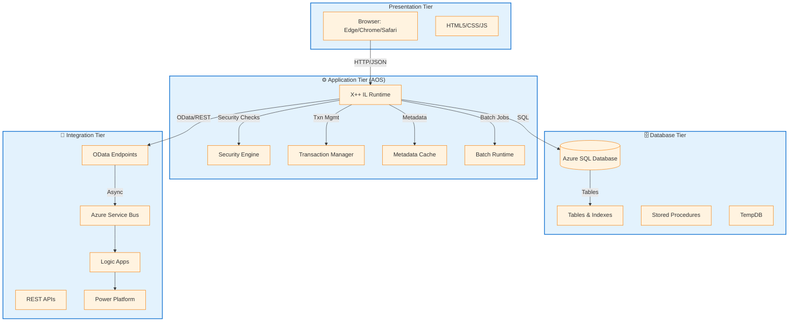

---

## 2. Request Flow Lifecycle

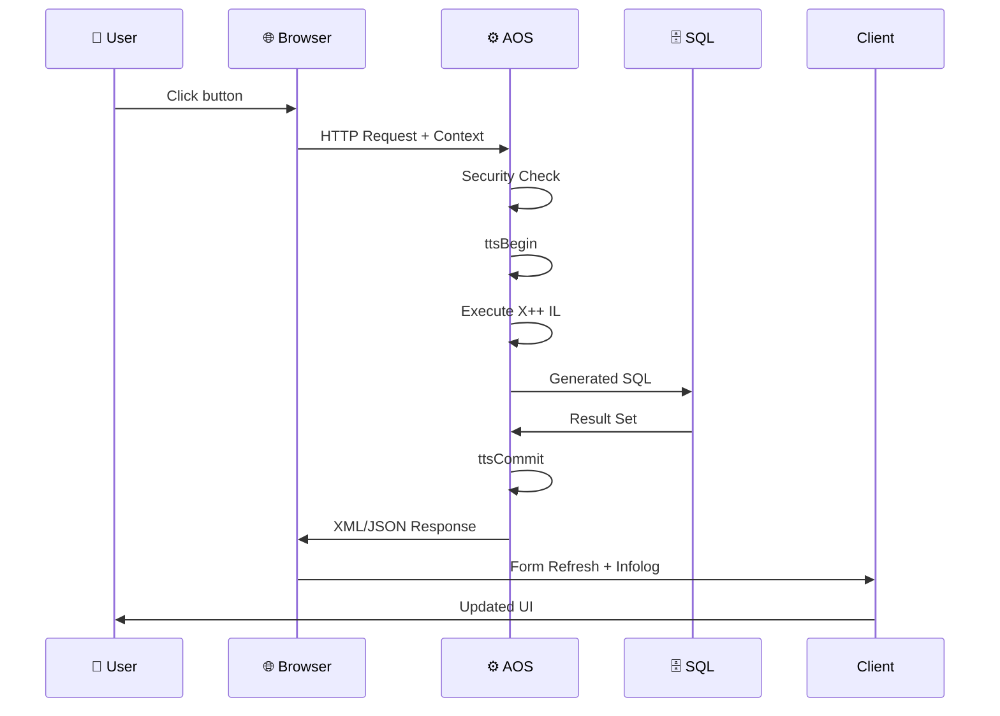

---

## 3. Layer Hierarchy (SYS → USR)

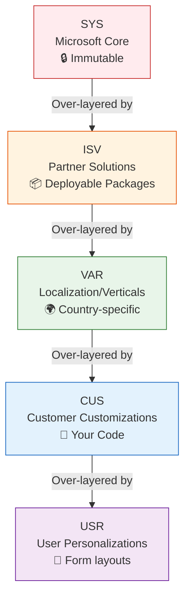

---

## 4. Chain of Command (CoC) Execution Order

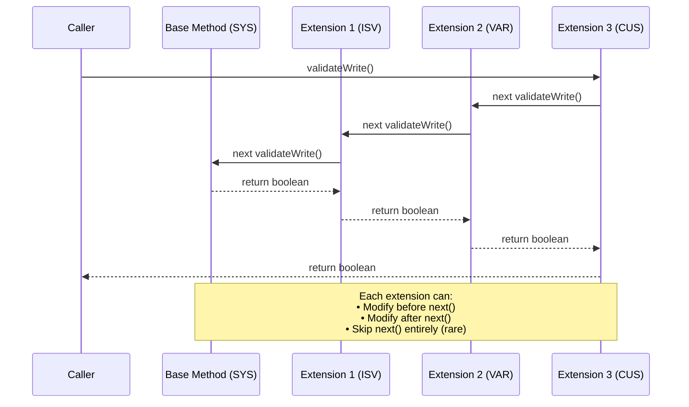

---

## 5. Security Hierarchy

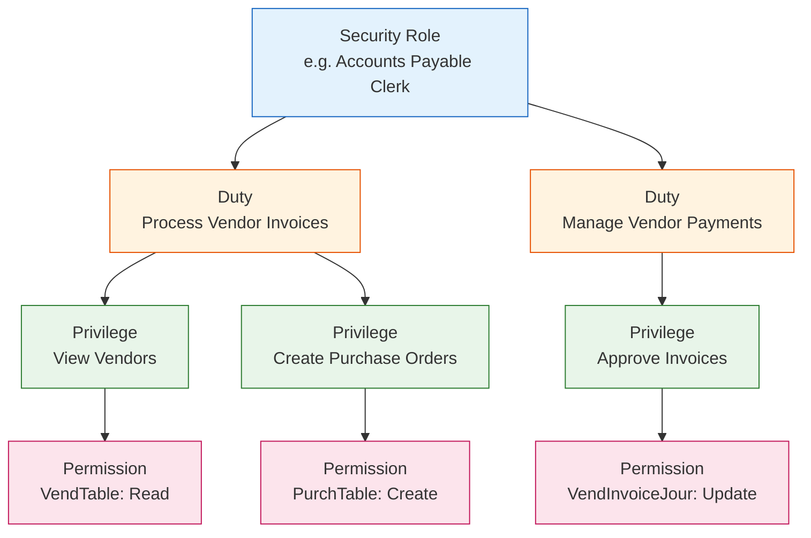

---

## 6. Extensible Data Security (XDS) Flow

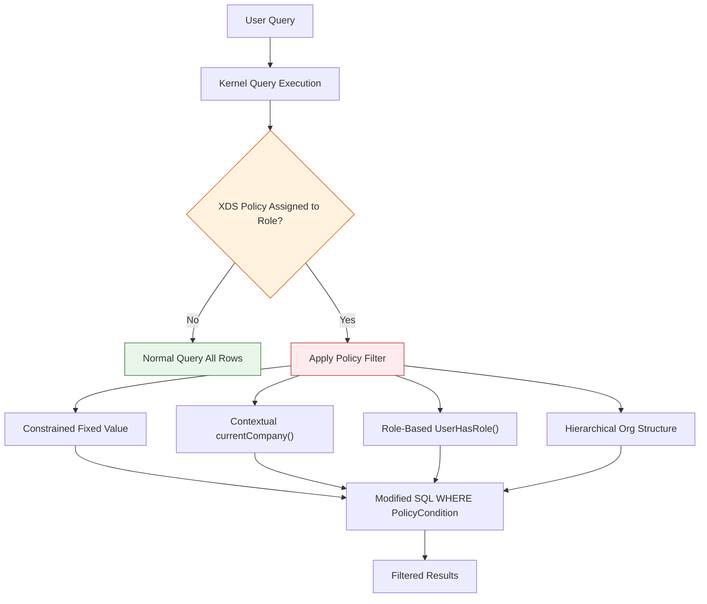

---

## 6. Batch Processing Architecture

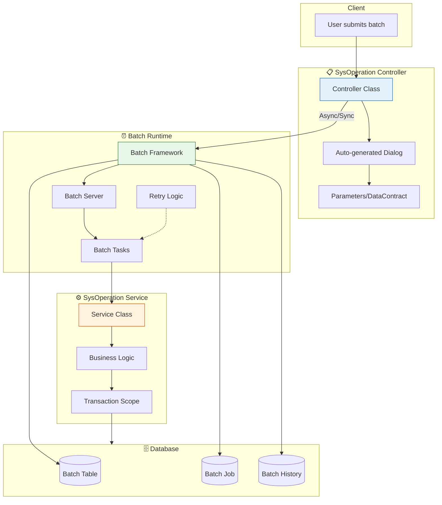

---

## 7. Data Entity Staging Pattern

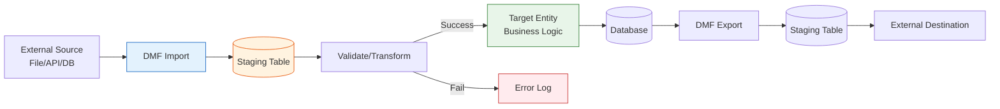

---

## 8. SysOperation Pattern (Controller → Service)

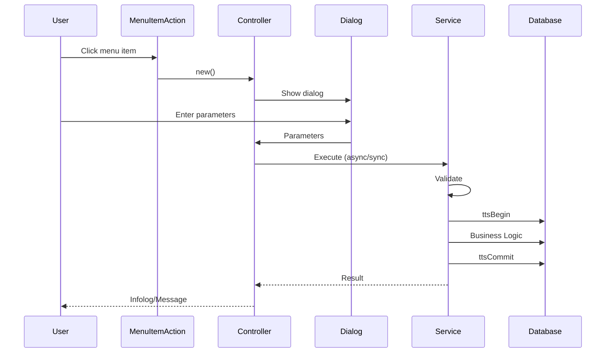

---

## 9. Number Sequence Flow

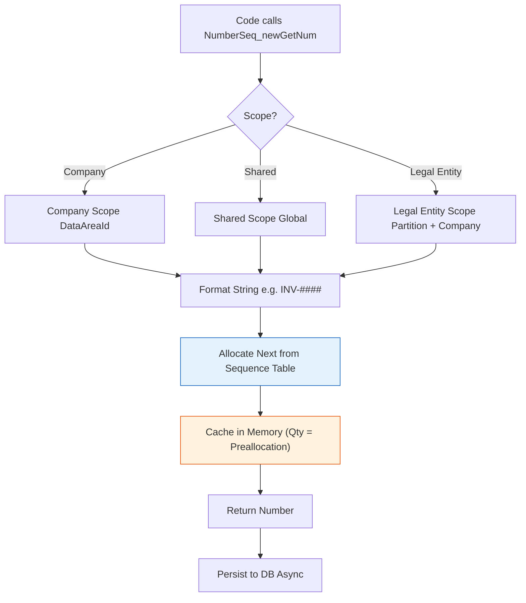

---

## 10. Form Architecture (MVC-ish)

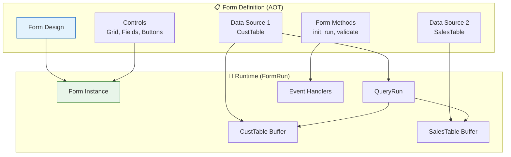

---

## 11. Test Pyramid

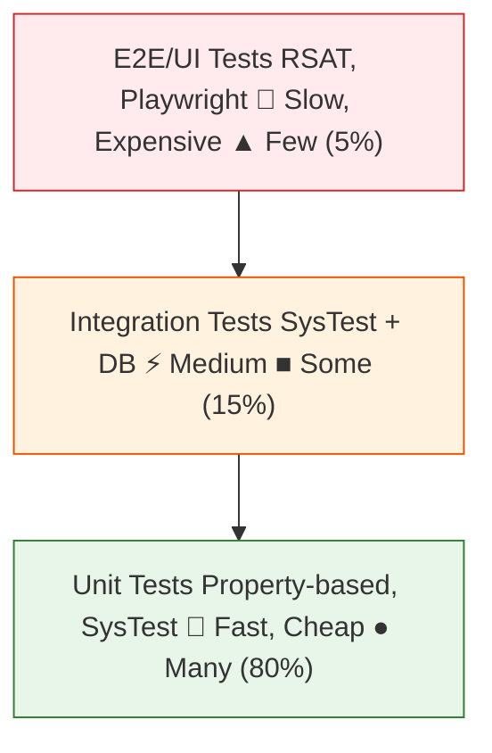

---

## 12. CI/CD Pipeline Flow

```mermaid
graph LR
    Dev[Developer] -->|Push| Git[Git Repo]
    Git -->|Trigger| Build[Build Pipeline]
    Build -->|Compile| Compile[X++ Compile]
    Compile -->|BP Check| BP[Best Practice]
    BP -->|Unit Test| Unit[SysTest]
    Unit -->|Package| Package[.axmodel]
    Package -->|Artifact| Artifacts[Build Artifacts]
    Artifacts -->|Deploy| Release[Release Pipeline]
    Release -->|Tier-1| DevEnv[Tier-1 Dev]
    DevEnv -->|Validate| Smoke[Smoke Tests]
    Smoke -->|Promote| UAT[UAT via LCS]
    UAT -->|Approve| Prod[Production via LCS]

    style Build fill:#e3f2fd,stroke:#1565c0
    style Release fill:#e8f5e9,stroke:#2e7d32
    style Artifacts fill:#fff3e0,stroke:#e65100
```

---

## 13. How to Render These

### In VS Code:
1. Install **"Markdown Preview Mermaid Support"** extension
2. Open this file → `Ctrl+Shift+V` (Preview)

### In GitHub:
- Automatically renders in `.md` files

### In Notion/Obsidian:
- Paste into a code block with `mermaid` language

### In MkDocs (Documentation Site):
```yaml
# mkdocs.yml
markdown_extensions:
  - pymdownx.superfences:
      custom_fences:
        - name: mermaid
          class: mermaid
          format: !!python/name:pymdownx.superfences.fence_code_format
```

---

## 14. Diagram Source Files

All diagrams above are **Mermaid.js source** — edit the code blocks to customize.

> **Tip:** Use [Mermaid Live Editor](https://mermaid.live/) to experiment before committing.

---

*Last verified: 2026-11-22 | Part of 35-Chapter Handbook*

---

